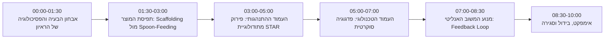

# MockMaster — מערך הרצאה ומצגת מעמיקה (10 דקות)
**המהות, המתודולוגיה והפסיכולוגיה של הדמיית ראיונות בעידן ה-AI**

---

## מבנה זמנים מדויק (10 דקות)

---

## 1. אבחון הבעיה: הדיסוננס הקוגניטיבי של המרואיין (00:00 - 01:30)

### הרעיון המרכזי לפתיחה:
רוב המועמדים אינם נכשלים בראיונות בגלל חוסר ידע מקצועי — הם נכשלים בגלל **עומס קוגניטיבי כפול (Cognitive Overload)**:
1. **המאמץ האלגוריתמי/תוכני:** לפתור את הבעיה בראש תחת שעון עצר.
2. **המאמץ התקשורתי:** לדבר בקול רם, להסביר את תהליך המחשבה (Think-Aloud Protocol), ולשדר ביטחון מול אדם זר.

### האסימטריה המובנית בראיונות עבודה:
- **מה המועמד חושב שמחפשים:** "האם הקוד שלי עובד ועובר את כל הטסטים?"
- **מה המראיין מחפש באמת:**
  - איך המועמד מגיב כשהוא נתקע?
  - האם הוא שואל שאלות הבהרה לפני שהוא רץ לכתוב קוד?
  - האם הוא יודע לתרגם ניסיון עבר לערך עסקי ואישי, או רק מדבר בסיסמאות כלליות?

### החסם בשוק הקיים:
- **פלטפורמות קיימות (כמו LeetCode):** שקטות לחלוטין. הן בוחנות קלט/פלט מול מחשב, ולא בוחנות שום מיומנות אנושית.
- **כלי AI גנריים (כמו ChatGPT):** סובלים מבעיית *Spoon-Feeding* — הם פולטים את הפתרון המושלם מיד. המועמד מעתיק את הקוד, חווה אשליה של הבנה (Illusion of Competence), אך בראיון האמיתי נותר חסר אונים.
- **סימולציות עם בני אדם:** יקרות מאוד (400–800 ₪ לשעה), מעוררות חרדה, ואינן מאפשרות מרחב בטוח לטעות 20 פעם ברצף.

---

## 2. תפיסת המוצר: לא לפתור עבורך — לבנות אותך (01:30 - 03:00)

> **תמצית המהות:** MockMaster אינה פלטפורמת פתרון שאלות, אלא **מערכת אימון קוגניטיבית מבוססת AI** שמדמה את המפגש הבין-אישי וההנדסי השלם.

### המודל מבוסס על תיאוריית הלמידה של ויגוצקי (ZPD - Zone of Proximal Development):
המערכת לעולם אינה נותנת את התשובה הסופית. היא מזהה את נקודת התקיעות של המשתמש ומציבה **פיגום (Scaffolding)** — רמז או שאלה שמקדמים אותו צעד אחד קדימה ביכולת העצמאית שלו.

### שני עמודי התווך של הפלטפורמה:
1. **הנדסה קוגניטיבית התנהגותית (HR & Culture Voice Session):** אימון על שפת גוף ורבלית, שיקוף אימפקט אישי ותרגול מתודולוגי בעברית שוטפת.
2. **סימולציית קוד סוקרטית (Interactive Coding Sandbox):** עבודה מעשית בסביבת פיתוח מלאה לצד דמויות מנטור בעלות פילוסופיות ראיון שונות.

---

## 3. העמוד ההתנהגותי: הנדסת שיחה ומתודולוגיית STAR (03:00 - 05:00)

### המראיינת: רותם (HR & Talent Director)
בראיון עם רותם, המועמד לא מקליד — **הוא מדבר בקולו**. המערכת מדמה שיחה טלפונית / שיחת וידאו אמיתית.

### פירוק עומק של מתודולוגיית STAR במערכת:
רותם אינה מסתפקת בשאלות שטחיות. המודל מתוכנת לזהות בזמן אמת את ארבעת רכיבי התשובה:
- **Situation (20% מהזמן):** הצגת ההקשר והרקע העסקי/הנדסי בתמצות, ללא גלישה לפרטים לא רלוונטיים.
- **Task (10% מהזמן):** הגדרה חדה של היעד והאחריות האישית של המועמד (הבחנה בין "מה הצוות עשה" לבין "מה אני עשיתי").
- **Action (50% מהזמן):** הליבה של התשובה — אילו החלטות טכנולוגיות התקבלו? אילו אלטרנטיבות נפסלו ולמה? איך נוהל המשבר מול ממשקים אחרים בארגון?
- **Result (20% מהזמן):** התוצאה המדידה — שיפור באחוזים, חיסכון בזמני ריצה, מניעת נפילת Production, או משוב ישיר מהלקוח/ההנהלה.

### התאמת תוכן דינמית לפי תפקיד (Contextual Role Alignment):
כשמועמד מקליד תפקיד, המערכת משנה לחלוטין את הדילמות שהיא מייצרת:
- **מפתח/ת Full Stack:** קונפליקטים על ארכיטקטורת State Management, לחץ לשחרור גרסה עם חוב טכנולוגי (Tech Debt).
- **איש/אשת DevOps:** טיפול ב-Outage בזמן אמת, ויכוחים על אבטחת מידע מול מהירות הפצה.
- **חוקר/ת Data Science:** התמודדות עם Data Drift, פער בין תוצאות מחקר לבין ביצועים בפועל ב-Production.

---

## 4. העמוד הטכנולוגי: פדגוגיה סוקרטית ודמויות מראיינים (05:00 - 07:00)

### שרה חן (Staff Software Engineer) — המנטורית הסוקרטית
שרה מייצגת את מודל המראיין המודרני בחברות טכנולוגיה מתקדמות — מראיין שמחפש **פוטנציאל ויכולת שיתוף פעולה**:
- **דיאלוג הדרגתי (4 רמות הכוונה):**
  1. *רמת אינטואיציה:* "תחשוב על הבעיה בלי מחשב בכלל, עם דף ועיפרון. איך עין אנושית סורקת את הנתונים?"
  2. *רמת כוח גס (Brute-Force Trade-off):* "מה הסיבוכיות אם נבדוק כל זוג אפשרי? למה זה לא יעבור את האילוצים שהוגדרו?"
  3. *רמת מבנה נתונים:* "איזה מבנה נתונים מאפשר לנו לחפש איבר בזמן של $O(1)$ במקום לרוץ שוב על כל המערך?"
  4. *רמת מקרי קצה:* "האם בדקת מה קורה כשהמערך מכיל מספרים שליליים או ערכים כפולים?"

### מרקוס ואנס (Bar Raiser) — בקרת איכות הנדסית ללא פשרות
עבור מועמדים מתקדמים, המערכת מאפשרת להחליף פרסונה למרקוס:
- דורש הוכחות מתמטיות של סיבוכיות זמן וזיכרון (Big-O).
- מאתגר הנחות יסוד: *"אם הקלט יגדל מ-1,000 ל-1,000,000,000 — איפה המערכת תקרוס קודם: ב-CPU או ב-RAM?"*

---

## 5. מנוע המשוב האנליטי: Feedback Loop סגור ומבוסס ראיות (07:00 - 08:30)

> רוב הסימולציות נותנות משוב עמום: *"היית בסדר, תשתפר במבנה"*. MockMaster מספקת **דוח מבוסס ראיות (Evidence-Based Critique)**.

### איך נוצר דוח הסיום?
1. **עיבוד התמליל המלא:** המערכת אינה בודקת רק "נכון/לא נכון", אלא מנתחת את כל חילופי הדברים שהתקיימו בראיון.
2. **חילוץ ציטוטים אותנטיים:**
   - **נקודות חוזק (Strong Answers):** ציטוט מילה-במילה של משפטים שבהם המועמד הפגין חשיבה עצמאית, לקיחת אחריות או הבנה עסקית עמוקה.
   - **נקודות לשיפור (Weak Answers):** ציטוט מדויק של תשובות עמומות, קצרות מדי או כאלו שהחסירו את רכיב התוצאה (Result), יחד עם הסבר איך היה נכון לנסח אותן.
3. **המלצת גיוס פורמלית (Hiring Verdict):**
   - סיווג מקצועי לפי סטנדרט תעשייה מקובל: **Strong Hire**, **Hire**, **Lean Hire**, **No Hire**.
   - ציונים נפרדים על: תקשורת בינאישית, מתודולוגיית STAR, פתרון בעיות, ואותנטיות.

---

## 6. אימפקט, בידול וסגירה (08:30 - 10:00)

### מטריצת הבידול של MockMaster:

| מאפיין | פלטפורמות קוד (LeetCode) | ChatGPT רגיל | סימולטור אנושי | MockMaster |
| :--- | :---: | :---: | :---: | :---: |
| **ראיון קולי אינטראקטיבי** | ❌ | ❌ | ✅ | **✅ (טבעי בעברית)** |
| **הדרכה סוקרטית (ללא פליטת פתרון)** | ❌ | ❌ | ✅ | **✅ (מובנית ב-AI)** |
| **דוח אנליטי מבוסס ציטוטים** | ❌ | ❌ | חלקי (סובייקטיבי) | **✅ (מבוסס STAR)** |
| **התאמה אישית לכל תפקיד** | ❌ | חלקי | מוגבל למומחיות המראיין | **✅ (כל משרה בהייטק)** |
| **זמינות ועלות** | מנוי חודשי | מוגבל | 400-800 ₪ לשעה | **זמין 24/7 ללא הגבלה** |

### משפט המחץ לסיכום ההרצאה:
> *"הפער בין מתכנת טוב לבין מתכנת שמתקבל לעבודה אינו כמות הקוד שהוא יודע לכתוב — אלא היכולת שלו לתקשר את הערך שלו תחת לחץ. MockMaster סוגרת בדיוק את הפער הזה, והופכת מועמד טוב למועמד בלתי ניתן לעצירה."*
